# DOA Estimation using Deep Learning-based Grid Search for Unknown and Variable Signal Numbers

Deep learning-based direction of arrival (DOA) estimators have shown superior performance compared to traditional model-based DOA estimators in many scenarios. However, most deep learning-based DOA estimators are only applicable for a fixed number of signals or a predefined range of signal quantities, limiting their practicality and flexibility in real applications. This paper proposes a DeepSSE based on deep learning for spatial spectrum estimation (DeepSSE), which has significant generalization capabilities under unknown and variable signal quantities, without being limited by the maximum signal quantity in the training data. This capability is achieved through the use of a novel angle grid search (AGS) process and an asymmetric loss (ASL). AGS simulates the process of multiple signal classification (MUSIC) algorithm, enabling DeepSSE to detect as many target DOAs as possible; ASL enhances DeepSSE's performance in multi-signal scenarios by overcoming the imbalance between positive and negative angle grids. Additionally, this paper introduces the optimal subspace assignment (OSPA) metric for DOA estimation for the first time, addressing the lack of performance evaluation metrics in scenarios with variable signal quantities. Numerical results show that DeepSSE outperforms other DOA estimators in various scenarios, especially when the number of signals far exceeds the maximum quantity in the training set.
Introduction: Direction of arrival (DOA) estimation is an active area in array signal processing, with applications in automotive radar, mobile user or mm-wave positioning, and drone surveillance among others. The emergence of future wireless communication technologies, particularly joint perception and communication, further stimulates research interest in DOA estimation. However, the increasingly complex electromagnetic environment poses significant challenges to DOA estimation, such as the possibility of variable and unknown signal quantities, making DOA estimation more difficult.
Over the past few decades, subspace-based estimators such as MUSIC, Root-MUSIC, and ESPRIT have achieved significant success in DOA estimation. Similarly, compressed sensing-based estimators like l₁-SVD, JLZA-DOA, and L₁-SRACV have also shown promising performance. These algorithms are based on the precise mathematical description of both signals and arrays, which can be referred to as model-driven methods. However, these model-driven methods are often sensitive to assumptions about the array and signal models, and their computational complexity is high, especially when relying heavily on accurate estimates of the number of signals, which often leads to a significant decrease in estimation accuracy in scenarios with variable signal quantities.
In recent years, there has been a surge in deep learning (DL)-based DOA estimators, offering stronger robustness and performance compared to model-driven methods. In these studies, the DOA estimation problem is often treated as a regression task for DOA values or a classification task for angle grids. These methods learn a mapping between signals and DOAs from training data, which can be referred to as data-driven methods. Data-driven methods have shown superior performance and robustness in certain scenarios, but are limited by the assumption of fixed signal quantities in training data and network architecture, which severely restricts their applicability in real-world scenarios where signal quantities are often dynamic. Most data-driven methods are based on the assumption of fixed signal quantities, which significantly limits the algorithm's practical application in real-world settings, as the actual number of signals is often variable.
Some studies have attempted to apply DL-based DOA estimators to scenarios with varying signal quantities. Some research divides the spatial spectrum into multiple angle subregions, using parallel neural networks to estimate DOA for each subregion individually, but this approach cannot handle multiple signals within the same angle subregion; others train different models for varying numbers of signals, which significantly increases training costs and run-time complexity, and estimation accuracy strictly depends on the accuracy of the signal quantity estimation; additionally, some methods model DOA estimation as a multi-label classification problem and use binary cross-entropy loss to train neural networks. This method performs well within the range of signal quantities trained on, but its robustness significantly drops when the number of signals exceeds the quantity in the training data, and due to the sparsity of the spatial spectrum, binary cross-entropy loss is not suitable for DOA estimation.
Recently, model-based deep learning methods have attracted widespread attention in the field of DOA estimation, some of which are suitable for multi-signal scenarios. These algorithms generally outperform data-driven DL methods in terms of estimation accuracy and computational complexity. However, most methods simply replace certain intermediate mathematical steps with neural networks, known as DNN-assisted inference. For example, someone uses recurrent neural networks (RNN) instead of computing the covariance matrix in MUSIC, and employs deep neural networks (DNN) for noise subspace computation; another uses an autoencoder as the frontend module to provide denoising and decorrelation capabilities. These methods have some limitations: firstly, they often incorporate matrix operations such as singular value decomposition (SVD) into neural networks, which can cause gradient instability during backpropagation. When training data contains significant signal parameter changes, the training process tends to become unstable, so these methods perform best in static and stable environments; furthermore, they lack specific mechanisms for varying signal quantities. Although some studies have designed retroactive training signal quantity classifiers for different signal quantities, they still rely on training data, making it difficult to handle scenarios with signal fluctuations.
To overcome these limitations, inspired by the model-based deep learning paradigm known as neural building blocks, this paper proposes a Deep Learning-based Spatial Spectrum Estimator (DeepSSE). Unlike existing methods, DeepSSE can effectively work even when the number of signals is much larger than the number in the training data. This approach achieves two key innovations: First, the architecture of DeepSSE includes a parameter-learnable subnetwork that simulates the angle grid search process of the MUSIC algorithm. This specially designed mechanism enables DeepSSE to accurately detect all DOA by searching on each angle grid; Second, it uses an asymmetric loss (ASL) to address the issue of spatial spectrum sparsity. ASL effectively balances the significant imbalance between positive and negative angle grids, allowing DeepSSE to focus on searching for positive angle grids without strictly focusing on negative ones. These two innovations significantly enhance the performance of DeepSSE in scenarios with varying signal numbers. By combining model-driven design with data-driven methods and optimizing the spatial spectrum sparse representation during training, DeepSSE provides a robust solution for DOA estimation in dynamic electromagnetic environments.
It is our understanding that this is the first time a DL-based DOA estimator has been proposed for variable scenarios where the number of signals far exceeds the number present in the training data. The main contributions of this paper are as follows:
The DeepSSE, a model-based deep learning DOA estimator, is proposed. It simulates the MUSIC angle grid search process and handles unknown and variable number of signals. Even when the number of signals far exceeds the number of signals in the training data, DeepSSE can achieve high DOA estimation accuracy without prior knowledge of signal number, significantly outperforming existing model-driven and data-driven DOA estimators. DeepSSE is designed to be easy to train, has strong generalization capability, and is robust to changes in signal number, number of shots, SNR, and mismatched signal and array models. It is suitable for DOA estimation in various scenarios.
Non-symmetric loss (ASL) is used to enhance the multi-signal DOA estimation performance of DeepSSE. ASL addresses one key training challenge in DOA estimation, i.e., the positive angle grid (equal to the target DOA) is much less than the negative angle grid. ASL balances these two angle grids by focusing more on the positive angle grid during training, making DeepSSE focus on searching the positive angle grid while paying less attention to the negative angle grid. To our knowledge, this is the first work considering the imbalance characteristics of training labels and applying ASL to a deep learning-based DOA estimator.
An optimal subspace allocation (OSPA) metric for evaluating DOA estimators in scenarios with varying number of signals is studied. OSPA is more reasonable and effective than other metrics used in previous works in measuring the performance of multi-signal estimation, providing a benchmark for future performance evaluation of multi-signal DOA estimators.
The performance of DeepSSE was evaluated through extensive simulation experiments, comparing it with the state-of-the-art deep learning and model-driven DOA estimators in terms of estimation accuracy and computational complexity. The experiments were conducted under varying signal quantities, number of frames, and signal-to-noise ratio conditions, taking into account different types of model mismatches. The experimental results indicate that DeepSSE possesses strong generalization capabilities, maintaining excellent performance across various scenarios. An integrated analysis of hyperparameters and the impact of different subnetworks was also conducted.
Figure caption:
Conclusion This paper introduces a novel model-based deep learning-driven DOA estimation algorithm, DeepSSE, designed to handle variable and unknown signal quantities. DeepSSE features a learnable parameterized grid search structure with three subnetworks. Training DeepSSE using ASL addresses the impact of spatial spectral sparsity on network training. Additionally, OSPA is used as an evaluation metric for scenarios involving variable and unknown signal quantities to assess the algorithm's performance. In simulation experiments, the effects of varying signal quantities, signal-to-noise ratio, number of frames, and model mismatches were analyzed under different experimental settings. DeepSSE outperformed other deep learning and model-based DOA estimators in various experiment configurations, maintaining a good balance between parameter size and runtime complexity while achieving exceptional estimation accuracy. The hyperparameter analysis and ablation experiments also provide references for adjusting DeepSSE in practical applications.
Despite the outstanding performance of DeepSSE in various scenarios, there are still several research directions to explore. The covariance matrix used in DeepSSE serves as an effective input feature representation for spatial features, but other input features such as IQ raw data and STFT spectrogram currently have some limitations. More efficient input features could further enhance the performance and robustness of DeepSSE. Network modules specifically designed for reconstructing ideal covariance matrices can also improve model mismatch robustness, which has been deeply explored in related studies. Finally, exploring lightweight variants of attention mechanisms or other more efficient network architectures will reduce computational complexity, which is particularly beneficial for resource-constrained devices lacking parallel matrix computation capabilities. These improvements can significantly expand the applicability of DeepSSE.

## Images

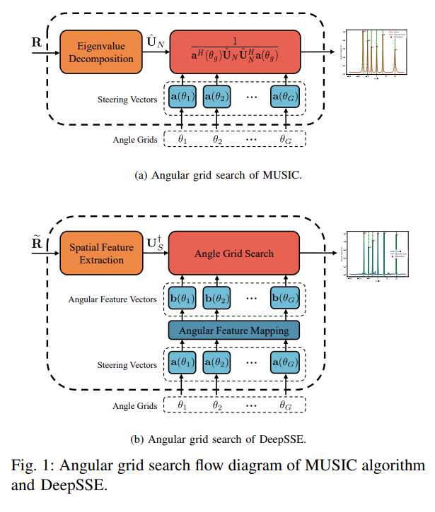
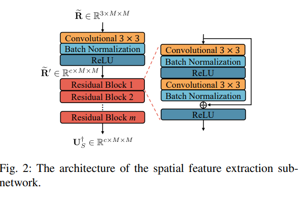
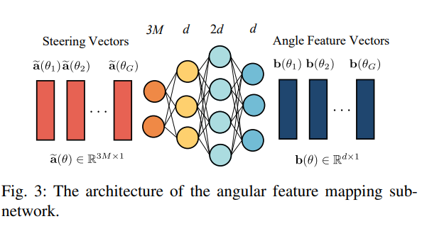
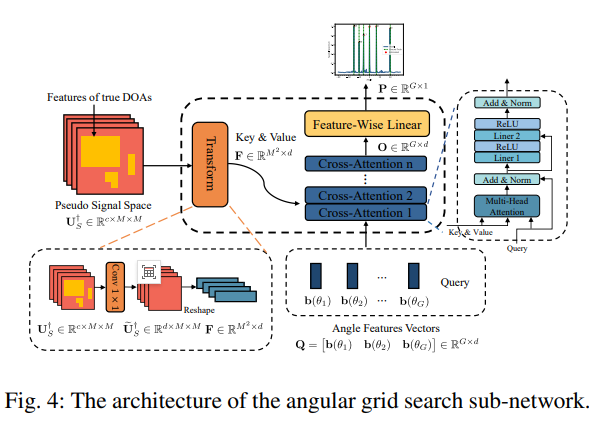
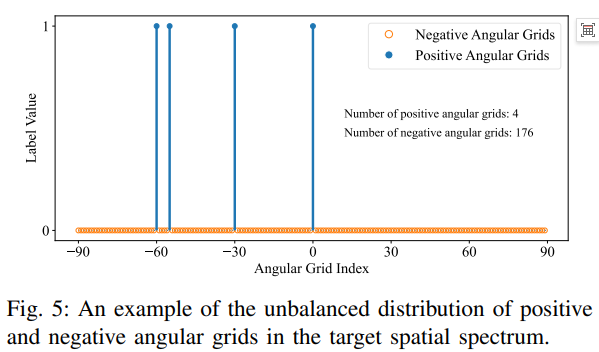
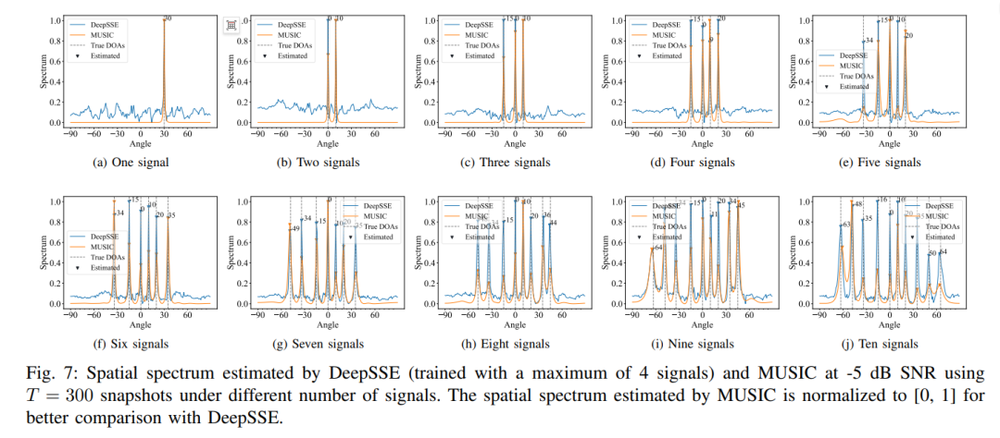
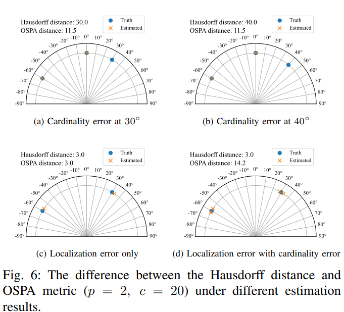
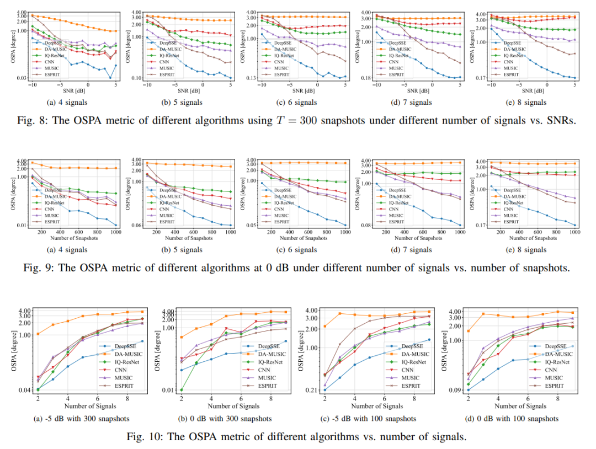
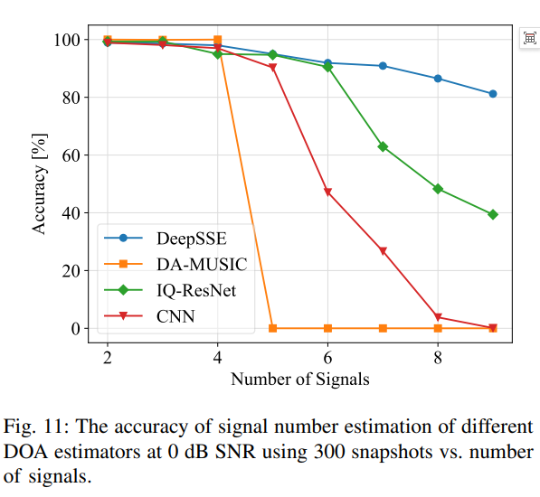
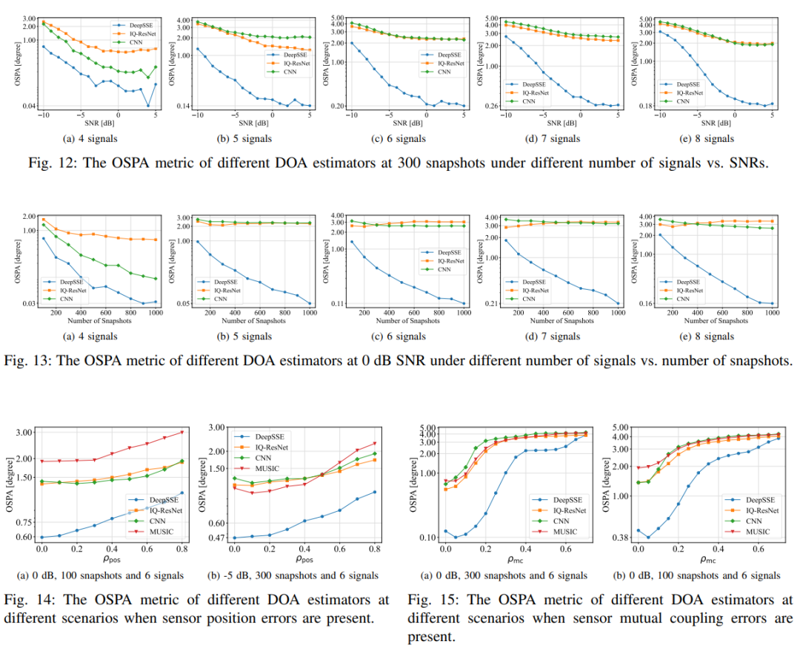
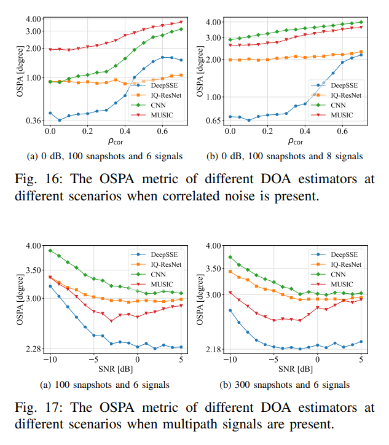
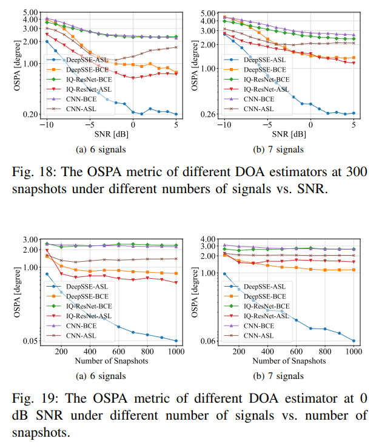

<!-- PAYMENT_BLOCK -->

## Get this dataset

- Payment link (Stripe): [Buy now](https://buy.stripe.com/3cs8yP7sY87d0vu9AB)
- Payment QR code: 

<!-- /PAYMENT_BLOCK -->
